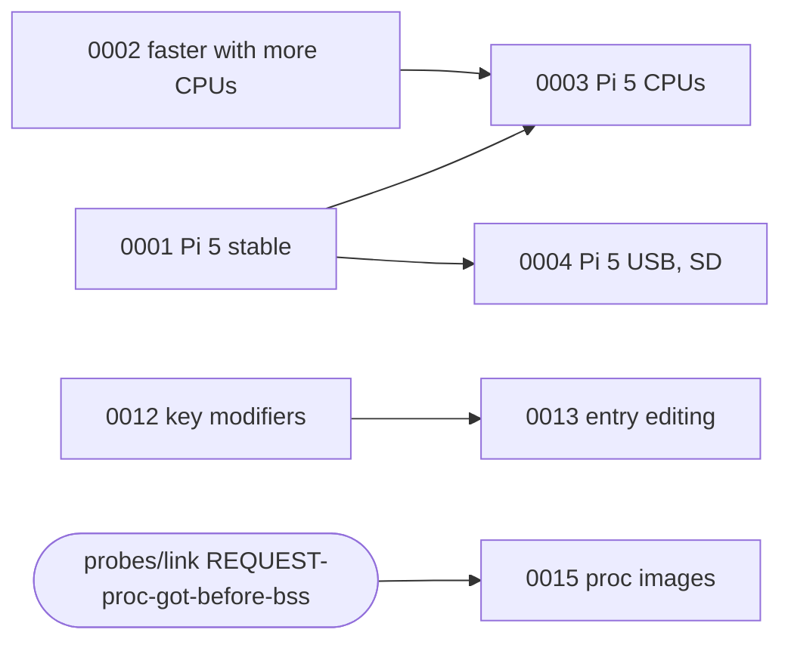

# L0S roadmap

The [spec](../spec/README.md) says what L0S is. A goal here says what will
change, and changes the spec as its steps land. Goals in different tracks
move independently, so several can be active at once.

## How it works

- **A goal** is one file, `NNNN-slug.md`, numbered in the order written:
  Why, Done when, Steps (a checklist), Spec changes, Log. The template is
  at the end of this page.
- **Status**: `idea` (no steps yet), `ready` (has steps, Needs all met),
  `active` (being worked on), `blocked` (a Need is not met), `done`,
  `dropped`.
- **Progress** is ticked steps over all steps. An `idea` shows `–`.
- **Needs**: other goals by number, `L0 NNNN` (an item in L0's roadmap),
  or an open `probes/…/REQUEST-*.md`. Whatever a goal needs comes first.
- **Spec**: the pages it changes. A step that lands moves its part of
  Spec changes into those pages, in the same change, and ticks the step
  here and in the goal.
- **Picking what's next**: choose from Ready. An `idea` becomes `ready`
  once it has steps.

## Goals

| Goal | Track | Status | Progress | Needs | Spec |
|---|---|---|---|---|---|
| [0001](0001-pi5-stable.md) The Pi 5 boots reliably | Pi 5 | idea | – | – | pi5.md, kernel.md |
| [0002](0002-faster-with-more-cpus.md) More CPUs make L0S faster | Kernel | idea | – | – | kernel.md |
| [0003](0003-pi5-cpus.md) All four of the Pi 5's CPUs | Pi 5 | blocked | – | 0001, 0002 | pi5.md, kernel.md |
| [0004](0004-pi5-devices.md) USB and the SD card on the Pi 5 | Pi 5 | blocked | 0/3 | 0001 | devices.md, storage.md, pi5.md |
| [0005](0005-hvs-frame-interrupts.md) The HVS's end-of-frame interrupts | Display | idea | – | – | display.md |
| [0006](0006-paced-display-queue.md) A paced, pipelined display queue | Display | idea | – | – | display.md, toolkit.md |
| [0007](0007-viewports-subsurfaces.md) Source viewports and subsurfaces | Display | idea | – | – | display.md, desktop.md |
| [0008](0008-cursor-shapes.md) A cursor set and cursor shapes | Display | idea | – | – | display.md, desktop.md, toolkit.md |
| [0009](0009-alpha-layers.md) Alpha layers: shadows and smooth corners | Display | idea | – | – | display.md, desktop.md |
| [0010](0010-output-events.md) Output events for mode changes | Display | idea | – | – | display.md, desktop.md |
| [0011](0011-csd-complete.md) Client-side decorations: maximize and resize | Desktop | ready | 0/2 | – | desktop.md, toolkit.md |
| [0012](0012-key-modifiers.md) Modifier state in `KeyEvent` | Desktop | idea | – | – | desktop.md, toolkit.md |
| [0013](0013-entry-editing.md) Entries that scroll, select, copy and paste | Toolkit | blocked | – | 0012 | toolkit.md |
| [0014](0014-wheel-across.md) Scrolling by the wheel across | Toolkit | idea | – | – | toolkit.md |
| [0015](0015-proc-image-got.md) Proc images without `.bss`'s zeros | Tooling | blocked | 0/2 | [REQUEST-proc-got-before-bss](../probes/link/REQUEST-proc-got-before-bss.md) | kernel.md, boot.md |

## Ready

- [0011](0011-csd-complete.md) Client-side decorations: maximize and resize

## Dependencies



## Done

None yet.

## Template

```markdown
# NNNN: Title

Track: … · Status: … · Needs: … · Spec: page.md, …

## Why

The problem, linking the spec's Limit it lifts if it lifts one.

## Done when

- Checkable outcomes, including the tests that show them.

## Steps

- [ ] One change each, that leaves `make check` and `make test` passing.

## Spec changes

What the spec will say once this is done, page by page. Each moves into
spec/ with the step that makes it true.

## Log

- YYYY-MM-DD: what happened.
```
