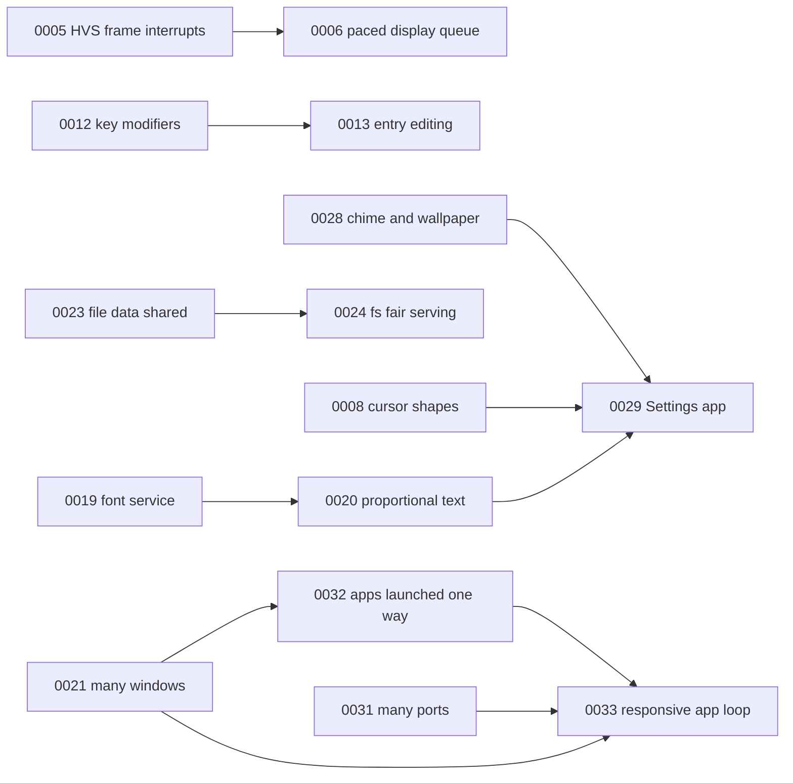

# L0S roadmap

The [spec](../spec/README.md) says what L0S is. A goal here says what will
change, and changes the spec as its steps land. Goals in different tracks
move independently, so several can be active at once.

## How it works

- **A goal** is one file, `NNNN-slug.md`, numbered in the order written:
  Why, Done when, Steps (a checklist), Spec changes, Log. The template is
  at the end of this page.
- **Status**: `idea` (no steps yet), `ready` (has steps, Needs all met),
  `active` (being worked on), `blocked` (a Need is not met), `done`,
  `dropped`.
- **Progress** is ticked steps over all steps. An `idea` shows `–`.
- **Needs**: other goals by number, `L0 NNNN` (an item in L0's roadmap),
  or an open `probes/…/REQUEST-*.md`. Whatever a goal needs comes first.
- **Spec**: the pages it changes. A step that lands moves its part of
  Spec changes into those pages, in the same change, and ticks the step
  here and in the goal.
- **Picking what's next**: choose from Ready. An `idea` becomes `ready`
  once it has steps.

## Goals

| Goal | Track | Status | Progress | Needs | Spec |
|---|---|---|---|---|---|
| [0005](0005-hvs-frame-interrupts.md) The HVS's end-of-frame interrupts | Display | ready | 0/5 | – | display.md, pi5.md |
| [0006](0006-paced-display-queue.md) A paced, pipelined display queue | Display | blocked | 0/6 | 0005 | display.md, desktop.md, toolkit.md |
| [0007](0007-viewports-subsurfaces.md) Source viewports and subsurfaces | Display | idea | – | – | display.md, desktop.md |
| [0008](0008-cursor-shapes.md) A cursor set and cursor shapes | Display | idea | – | – | display.md, desktop.md, toolkit.md |
| [0009](0009-alpha-layers.md) Alpha layers: shadows and smooth corners | Display | idea | – | – | display.md, desktop.md |
| [0010](0010-output-events.md) Output events for mode changes | Display | idea | – | – | display.md, desktop.md |
| [0012](0012-key-modifiers.md) Modifier state in `KeyEvent` | Desktop | idea | – | – | desktop.md, toolkit.md |
| [0013](0013-entry-editing.md) Entries that scroll, select, copy and paste | Toolkit | blocked | – | 0012 | toolkit.md |
| [0014](0014-wheel-across.md) Scrolling by the wheel across | Toolkit | idea | – | – | toolkit.md |
| [0017](0017-paths-without-walking.md) Find programs and apps without walking the whole of `/` | Storage | idea | – | – | boot.md, programs.md |
| [0018](0018-pi5-tftp-large.md) `tftp` fetches a file of megabytes on the Pi 5 | Network | idea | – | – | network.md |
| [0024](0024-fs-fair-serving.md) `fs` serves its clients fairly, small requests first | Storage | ready | 0/4 | 0023 | storage.md, testing.md |
| [0026](0026-font-service-limits.md) The font service lets strikes go, and knows who holds them | Toolkit | idea | – | – | programs.md, toolkit.md |
| [0027](0027-installer.md) Installing L0S, a process of its own, with a GUI | Storage | idea | – | – | boot.md, pi5.md, programs.md, storage.md, testing.md |
| [0029](0029-settings-app.md) Settings, an app for the system's configuration | Desktop | idea | – | 0028, 0008, 0020 | programs.md, desktop.md, toolkit.md, network.md, boot.md, pi5.md, testing.md |
| [0030](0030-cpu-usage.md) How the CPUs are used, and what each process serves, in `ps` and System Monitor | Kernel | idea | – | – | kernel.md, syscalls.md, programs.md, demo.md, testing.md |
| [0031](0031-many-ports.md) A process waits on several ports, and lets a name go | Kernel | active | 3/5 | – | syscalls.md, kernel.md, programs.md, devices.md, demo.md, testing.md |
| [0032](0032-app-launch.md) Apps launched one way: a running app is asked, not started again | Desktop | active | 4/6 | 0021 | desktop.md, toolkit.md, programs.md, testing.md |
| [0033](0033-responsive-app-loop.md) An app's loop that keeps its window answering | Toolkit | blocked | 0/7 | 0021, 0031, 0032 | toolkit.md, desktop.md, programs.md, testing.md |
| [0034](0034-servers-wait-not-poll.md) Servers that wait for their time and their ports, not poll | Kernel | idea | – | – | programs.md, network.md, storage.md, demo.md |

## Ready

- [0005](0005-hvs-frame-interrupts.md) The HVS's end-of-frame
  interrupts: on a Pi 5 with a monitor on HDMI0. Its first step may
  find it needs L0 to give the interrupt.
- [0024](0024-fs-fair-serving.md) `fs` serves its clients fairly,
  small requests first: 0023, which it needed, is done.
- [0031](0031-many-ports.md) A process waits on several ports, and lets
  a name go: the calls are in (300 to 303), and `usb-hid` can serve
  both inputs from one process; left, now 0021 has merged, `wm` telling
  its input's notices apart by what they say, the inittabs' one
  `usb-hid`, and Terminal's tabs without relays.
- [0032](0032-app-launch.md) Apps launched one way: the open request
  and its answer are in (`appopen.l0`), every toolkit app has its name
  and `app.open`, and `wm` launches through them, as `open` asks it;
  left, the apps' answers and the screen test.

## Dependencies



## Done

| Goal | Track | Done |
|---|---|---|
| [0001](0001-pi5-stable.md) The Pi 5 boots reliably | Pi 5 | 2026-10-26 |
| [0002](0002-faster-with-more-cpus.md) More CPUs make L0S faster | Kernel | 2026-10-28 |
| [0003](0003-pi5-cpus.md) All four of the Pi 5's CPUs | Pi 5 | 2026-10-28 |
| [0004](0004-pi5-devices.md) USB and the SD card on the Pi 5 | Pi 5 | 2026-10-27 |
| [0011](0011-csd-complete.md) Client-side decorations: maximize and resize | Desktop | 2026-10-27 |
| [0015](0015-proc-image-got.md) Proc images without `.bss`'s zeros | Tooling | 2026-10-26 |
| [0016](0016-pi5-eeprom-config.md) The Pi 5's boot config, read and changed from L0S | Pi 5 | 2026-10-27 |
| [0019](0019-font-service.md) A font service that caches rasterized glyphs | Toolkit | 2026-10-27 |
| [0020](0020-proportional-text.md) Proportional text where GNOME's is | Toolkit | 2026-10-28 |
| [0021](0021-many-windows.md) An app with many windows, its events told by window | Desktop | 2026-10-28 |
| [0022](0022-pi5-card-complete.md) `install --boot` writes all a Pi 5's card needs | Pi 5 | 2026-10-28 |
| [0023](0023-file-data-shared.md) File data through shared memory, in runs of 64 KB | Storage | 2026-10-27 |
| [0025](0025-vt-scrollback-resize-tabs.md) Terminal keeps its scrollback, resizes, and has tabs | Desktop | 2026-10-27 |
| [0028](0028-boot-chime-wallpaper.md) The chime as sound starts, the wallpaper as the screen does | Desktop | 2026-10-28 |

## Template

```markdown
# NNNN: Title

Track: … · Status: … · Needs: … · Spec: page.md, …

## Why

The problem, linking the spec's Limit it lifts if it lifts one.

## Done when

- Checkable outcomes, including the tests that show them.

## Steps

- [ ] One change each, that leaves `make check` and `make test` passing.

## Spec changes

What the spec will say once this is done, page by page. Each moves into
spec/ with the step that makes it true.

## Log

- YYYY-MM-DD: what happened.
```
